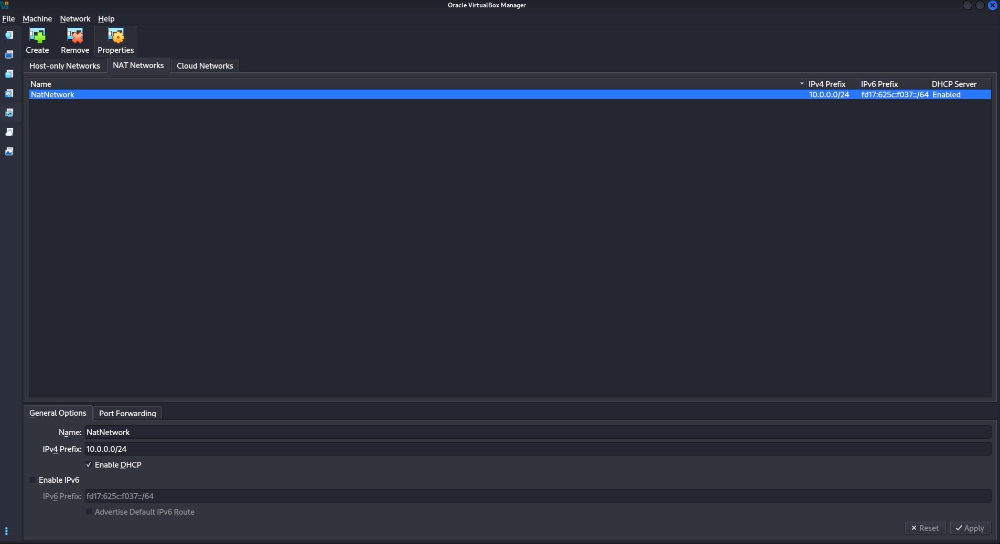
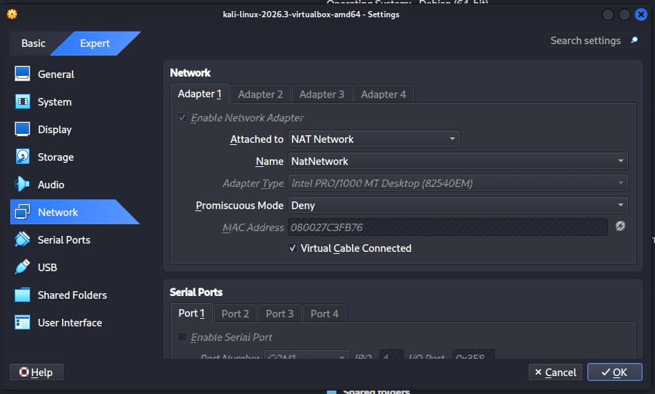
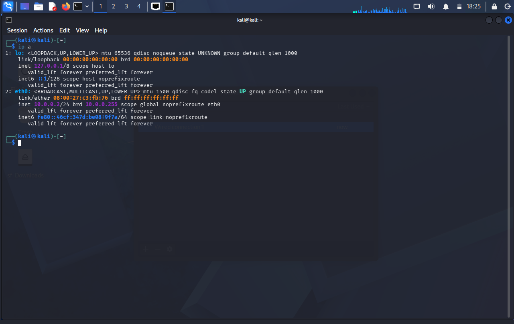
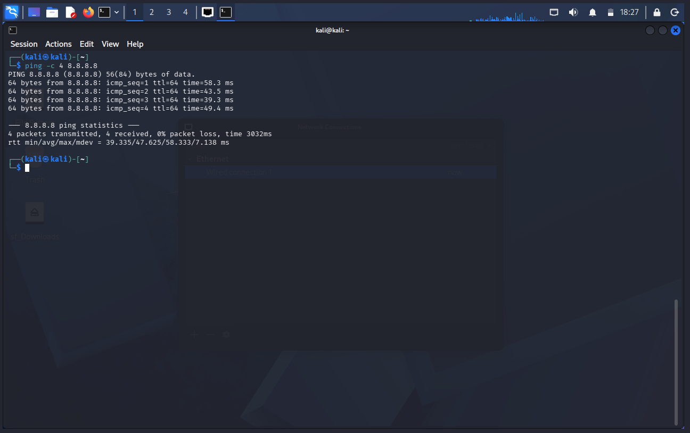
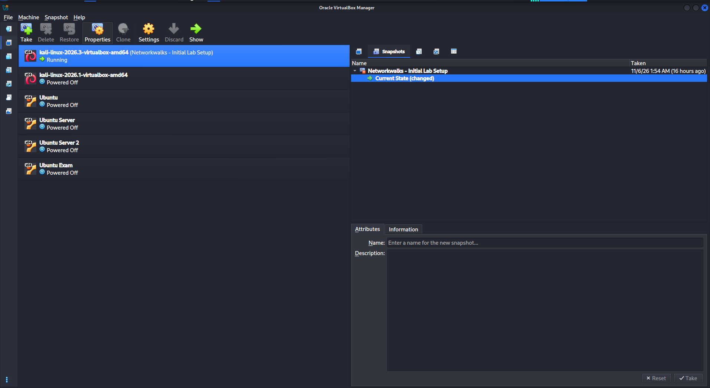

# Networkwalks Cybersecurity Lab Environment Setup

**Week 1 – Project Module 1: Practical Lab Environment Setup**

This repository documents my setup of a virtual cybersecurity lab using Oracle VirtualBox and Kali Linux. The lab provides a controlled environment for networking and cybersecurity practice.

> **Safety:** Use this environment only for systems you own or have explicit permission to test.

## Project objectives

- Import and configure Kali Linux as a virtual machine.
- Create a VirtualBox NAT Network.
- Configure a static IPv4 address for the Kali VM.
- Verify network and internet connectivity.
- Configure host–guest file sharing and clipboard integration.
- Create a clean VM snapshot for recovery.
- Document the configuration and troubleshooting steps.

## Lab configuration

| Component | Configuration |
|---|---|
| Hypervisor | Oracle VirtualBox 7.2.20 |
| Security VM | Kali Linux (VirtualBox image) |
| Virtual network mode | NAT Network |
| NAT Network name | `NatNetwork` |
| Network prefix | `10.0.0.0/24` |
| Kali VM IPv4 address | `10.0.0.2/24` |
| Default gateway | `10.0.0.1` |
| DNS server configured | `8.8.8.8` |
| Shared folder name | `downloads` |
| Host shared-folder path | `/home/kali/Downloads` |
| Snapshot | `Networkwalks - Initial Lab Setup` |

## Setup procedure

### 1. Install and prepare VirtualBox

Installed VirtualBox and updated it to version **7.2.20**.

### 2. Import the Kali Linux virtual machine

Imported the Kali Linux VirtualBox image and configured its network adapter to use the VirtualBox NAT Network named `NatNetwork`.

### 3. Configure the NAT Network

Created a NAT Network with the IPv4 prefix:

```text
10.0.0.0/24
```

The NAT Network provides a private virtual network for lab machines while allowing outbound connectivity.

### 4. Configure Kali's static IPv4 address

Configured the Kali network connection with NetworkManager:

```bash
sudo nmcli connection modify "Wired connection 1" ipv4.method manual ipv4.addresses 10.0.0.2/24 ipv4.gateway 10.0.0.1 ipv4.dns 8.8.8.8
sudo nmcli connection down "Wired connection 1"
sudo nmcli connection up "Wired connection 1"
```

During troubleshooting, the following setting was applied to the connection:

```bash
sudo nmcli connection modify "Wired connection 1" ipv4.dad-timeout 0
```

> NetworkManager connection names can differ. Check the actual connection name before running these commands.

### 5. Verify connectivity

Checked the assigned address:

```bash
ip addr show eth0
```

Confirmed that the interface had the address `10.0.0.2/24`.

Tested external IP connectivity and DNS resolution:

```bash
ping 8.8.8.8
ping google.com
```

Both tests returned successful replies.

### 6. Configure host–guest integration

Enabled bidirectional shared clipboard and drag-and-drop in the VM settings.

Configured a shared folder with:

- Folder name: `downloads`
- Host path: `/home/kali/Downloads`
- Auto-mount: enabled
- Read-only: disabled

The shared folder was tested successfully.

### 7. Create a recovery snapshot

Created a VirtualBox snapshot named:

```text
Networkwalks - Initial Lab Setup
```

This snapshot preserves the initial configured lab state and provides a recovery point before later experiments.

## Troubleshooting notes

### Static IP and connectivity

After configuring the static IPv4 address, the interface did not initially retain connectivity as expected. I adjusted the NetworkManager connection's duplicate-address-detection timeout and restarted the connection, then verified the address and connectivity again.

### Verification summary

| Check | Result |
|---|---|
| Kali address | `10.0.0.2/24` confirmed |
| Internet by IP | Successful ping to `8.8.8.8` |
| DNS / internet by hostname | Successful ping to `google.com` |
| Shared folder | Configured and tested |
| Snapshot | Created |

## What I learned

- How a VirtualBox NAT Network differs from connecting a VM to an ordinary NAT adapter.
- How to configure a static IPv4 address, gateway, and DNS server with NetworkManager.
- How to verify connectivity using `ip addr` and `ping`.
- How shared folders, clipboard integration, and drag-and-drop support file exchange between host and guest.
- Why a clean VM snapshot is useful before carrying out security experiments.
- Why documenting configuration and troubleshooting makes a lab easier to reproduce.

## Screenshots

The following screenshots document the lab configuration and verification.

| Evidence | Screenshot |
|---|---|
| VirtualBox NAT Network configuration |  |
| Kali VM network adapter settings |  |
| Kali static IP address |  |
| Internet connectivity tests |  |
| Initial lab snapshot |  |
## Tools and resources

- [Oracle VirtualBox](https://www.virtualbox.org/wiki/Downloads)
- [Kali Linux downloads](https://www.kali.org/get-kali/)

## Author

**Abdulsomad Idris**

Cybersecurity learner – Networkwalks

---

**Program:** Networkwalks Cybersecurity  
**Week:** 1  
**Project Module:** 1 – Practical Lab Environment Setup
